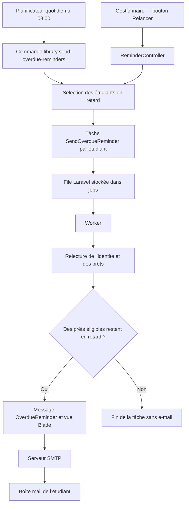

# Implémentation des relances automatiques par e-mail

Ce guide décrit le fonctionnement du code ESThèque et la configuration relevée sur Alwaysdata le 19 novembre 2026.

## 1. Objectif

Lorsqu’un étudiant dépasse la date de retour, ESThèque prépare un e-mail regroupant ses exemplaires encore en retard. Le gestionnaire peut également demander une relance individuelle ou groupée depuis son tableau de bord.

L’envoi passe par Laravel Mail, une file de tâches Laravel et un serveur SMTP. L’étudiant reçoit le message à l’adresse enregistrée dans l’annuaire ESThèque.

## 2. Parcours complet



La requête web ou la commande programme le travail. Le worker construit ensuite le message à partir des données disponibles au moment du traitement.

## 3. Détection d’un retard réel

La méthode `Loan::scopeOverdue()` dans [Loan.php](../app/Models/Loan.php) sélectionne les prêts qui respectent simultanément ces conditions.

```sql
returned_at IS NULL
AND cancelled_at IS NULL
AND due_at < maintenant
```

Un exemplaire rendu ou un prêt annulé sort de cette sélection. À l’échéance exacte, le prêt ne remplit pas encore la condition de retard.

[OverduePolicy.php](../app/Services/OverduePolicy.php) calcule les jours avec l’arrondi supérieur du nombre de secondes écoulées divisé par 86 400. Une journée de retard entamée compte donc pour un jour. Les niveaux sont dérivés de la durée de prêt configurée. Avec 30 jours, les seuils sont de 1 à 10 jours, de 11 à 20 jours, puis au-delà de 20 jours.

Les dates sont stockées en UTC et affichées avec le fuseau `Africa/Casablanca`.

## 4. Sélection des destinataires

[QueueOverdueReminders.php](../app/Console/Commands/QueueOverdueReminders.php) déclare la commande suivante.

```sh
php artisan library:send-overdue-reminders
```

Elle extrait les identifiants distincts des étudiants ayant un prêt en retard, puis les parcourt par lots de 200. Pour chaque lot, elle consulte `UserDirectory`, ce qui centralise l’accès aux identités.

Un destinataire doit exister dans l’annuaire, posséder le rôle `student` et avoir une adresse admise par `AcademicEmail::isValid()`. Cette validation inclut le domaine académique configuré et les exceptions personnelles explicitement présentes dans le code.

Le regroupement par identifiant évite de créer une tâche par livre. Un étudiant ayant trois exemplaires en retard reçoit un message contenant les trois lignes.

## 5. Déclenchement quotidien à 08:00

[routes/console.php](../routes/console.php) contient cette déclaration.

```php
Schedule::command('library:send-overdue-reminders')
    ->dailyAt(config('library.overdue_reminder_time'))
    ->timezone(config('library.timezone'))
    ->withoutOverlapping();
```

[config/library.php](../config/library.php) définit `overdue_reminder_time` à `08:00` et `timezone` à `Africa/Casablanca`. Le fuseau permet de suivre les changements d’heure du Maroc.

Le système d’hébergement appelle le planificateur Laravel chaque minute. Laravel décide si la commande est due à cet instant. Sur Alwaysdata, cette entrée se configure dans **Avancé → Tâches planifiées**, avec le répertoire de l’application et une fréquence d’une minute.

```sh
cd /home/biblio-estfes-demo/bibliotheque && php artisan schedule:run
```

Une installation doit utiliser une seule programmation quotidienne pour éviter les déclenchements redondants. Après une interruption à 08:00, la déclaration quotidienne seule ne rejoue pas automatiquement l’horaire manqué.

La commande suivante affiche la planification sans envoyer de message.

```sh
php artisan schedule:list --timezone=Africa/Casablanca
```

Le contrôle du 19 novembre a confirmé la déclaration quotidienne à 08:00. Cette commande vérifie le planning Laravel. L’activation effective de la tâche dans l’administration Alwaysdata et sa dernière exécution doivent être contrôlées dans l’hébergement.

## 6. Relances demandées par le gestionnaire

La route `POST /gerant/relances` est protégée par `auth`, `role:manager`, la protection CSRF du groupe web et une limitation de six requêtes par minute.

[ReminderController.php](../app/Http/Controllers/Manager/ReminderController.php) reçoit éventuellement un `student_id`.

- Avec cet identifiant, il cible l’étudiant concerné.
- Sans cet identifiant, il parcourt les étudiants admissibles ayant des retards.

Le contrôleur vérifie la configuration d’un transport d’envoi et recalcule les destinataires depuis les prêts. Les deux boutons utilisent `SendOverdueReminder`, comme la commande quotidienne.

Le retour affiché indique que la relance a été confiée à la file. Le compteur mesure les destinataires sélectionnés. Il ne prouve pas la livraison et peut inclure une tâche déjà en attente dont Laravel empêche le doublon.

## 7. Files de traitement et worker

Avec `QUEUE_CONNECTION=database`, les tâches sont stockées dans la table `jobs`.

Le code actuel utilise deux noms de file.

| Origine | File |
| --- | --- |
| Commande quotidienne | File par défaut de la connexion, `default` dans la configuration vérifiée |
| Bouton du gestionnaire | `library-reminders` |

Le worker doit écouter les deux files. Avec les noms relevés sur le serveur, la commande est la suivante.

```sh
php artisan queue:work database --queue=library-reminders,default --sleep=3 --tries=3 --timeout=60
```

Si `DB_QUEUE` est modifié, adapter le second nom. Un worker limité à `default` laisserait les relances manuelles en attente. L’ordre de la liste donne la priorité aux relances manuelles.

L’hébergement doit maintenir le worker actif avec un service supervisé. Une alternative sur un hébergement adapté est une tâche périodique qui vide les files puis s’arrête.

```sh
php artisan queue:work database --queue=library-reminders,default --stop-when-empty --tries=3 --timeout=60
```

Cette seconde méthode introduit un délai dépendant de sa fréquence. Le planificateur et le worker remplissent deux fonctions distinctes, déclencher puis traiter.

## 8. Relecture avant l’envoi

[SendOverdueReminder.php](../app/Jobs/SendOverdueReminder.php) conserve uniquement `studentId`. Au traitement, la tâche appelle `OverdueReport::forStudent()` pour recharger l’identité et les prêts.

Les cas suivants sont pris en charge.

| Situation avant le traitement | Résultat |
| --- | --- |
| Tous les exemplaires sont rendus ou les prêts annulés | Aucun e-mail |
| Un exemplaire sur trois a été rendu | Message contenant les deux retards restants |
| L’adresse a changé | Nouvelle adresse enregistrée utilisée |
| Le compte a été supprimé ou son rôle a changé | Aucun e-mail si le compte est devenu inéligible |
| Aucun retard admissible n’existe | Aucune tâche lors de la sélection initiale |

Cette relecture réduit le risque d’envoyer un rappel devenu inutile entre sa mise en file et son exécution.

## 9. Construction du message

[OverdueReminder.php](../app/Mail/OverdueReminder.php) définit l’objet **Bibliothèque EST Fès — retour de vos exemplaires en retard**.

La vue [overdue-reminder.blade.php](../resources/views/mail/overdue-reminder.blade.php) génère le HTML avec le logo ESThèque, le nom de l’étudiant et les informations suivantes pour chaque exemplaire.

- Titre et auteur.
- Identifiant de l’exemplaire.
- Date de retour prévue en heure du Maroc.
- Niveau et nombre de jours de retard.

L’échéance et le retard sont mis en évidence en rouge. Les valeurs interpolées avec `{{ ... }}` sont échappées par Blade.

L’image est chargée depuis l’URL produite par `asset()`. Une valeur correcte de `APP_URL` et un logo accessible en HTTPS permettent son affichage. Le logiciel de messagerie peut demander l’autorisation de charger les images distantes.

## 10. Expéditeur et SMTP

La configuration relevée sur Alwaysdata utilise le transport `smtp`, le nom **ESThèque** et l’adresse **bibliotheque@biblio-estfes-demo.alwaysdata.net**.

L’expéditeur provient de `mail.from`, alimenté par `MAIL_FROM_ADDRESS` et `MAIL_FROM_NAME`. Le destinataire est `$report->student->email`.

La connexion Google sert à l’authentification à l’application. L’envoi SMTP utilise les identifiants de la boîte d’expédition configurés sur le serveur.

Exemple de configuration à adapter à l’hébergeur.

```dotenv
APP_URL=https://votre-domaine
QUEUE_CONNECTION=database
CACHE_STORE=file
MAIL_MAILER=smtp
MAIL_SCHEME=smtp
MAIL_HOST=votre-serveur-smtp
MAIL_PORT=587
MAIL_USERNAME=votre-identifiant-smtp
MAIL_PASSWORD=votre-secret-smtp
MAIL_FROM_ADDRESS=votre-adresse-expediteur
MAIL_FROM_NAME="ESThèque"
```

L’hôte, le port et le schéma doivent correspondre au service SMTP choisi. Une connexion SMTP sur le port 587 et une connexion SMTPS sur le port 465 demandent les paramètres appropriés.

Les secrets restent dans l’environnement du serveur. Après modification de la configuration, recharger le cache et redémarrer les workers.

```sh
php artisan config:clear
php artisan queue:restart
```

Le contrôle a relevé un cache `file` sur cet hébergement. Les processus concernés doivent accéder au même cache pour partager les verrous. Un déploiement sur plusieurs machines nécessite un cache partagé adapté.

## 11. Doublons, reprise et limites

La tâche implémente `ShouldQueue` et `ShouldBeUnique`. Sa clé d’unicité est l’identifiant de l’étudiant. Le verrou expire au plus tard après `uniqueFor = 86400` secondes, et Laravel le libère aussi à la fin du traitement.

Cette protection évite deux tâches simultanément en attente pour le même étudiant. Une relance après la fin du traitement peut envoyer un nouveau message le même jour. Le projet ne possède pas de journal métier imposant un seul e-mail par jour et par étudiant.

La tâche autorise au maximum trois tentatives, avec des délais de reprise de 60 puis 300 secondes et un temps maximal de 60 secondes par tentative. La connexion de file en base utilise par défaut `retry_after = 90` secondes, supérieur au délai maximal de traitement.

Un échec définitif est consultable dans `failed_jobs`.

```sh
php artisan queue:failed
```

Pour relancer une tâche identifiée après diagnostic, la commande suivante peut être utilisée. Elle peut provoquer un nouvel envoi réel.

```sh
php artisan queue:retry IDENTIFIANT_DE_TACHE
```

Une coupure après acceptation SMTP peut laisser une incertitude sur l’envoi. Une reprise peut alors produire un doublon. L’acceptation par SMTP ne garantit pas l’arrivée en boîte principale, qui dépend aussi du filtrage du destinataire.

## 12. Vérification et diagnostic

Les tests [OverdueRemindersTest.php](../tests/Feature/OverdueRemindersTest.php) couvrent notamment le regroupement, les identités admissibles, les retours intervenus avant l’envoi, les retours partiels, l’unicité des tâches en attente, la sérialisation dans la file en base et un lot dépassant 200 étudiants.

```sh
php vendor/phpunit/phpunit/phpunit --filter=OverdueRemindersTest
```

Les tests simulent les e-mails et utilisent SQLite en mémoire. Pour tester manuellement sans destinataire réel, utiliser une installation isolée avec `MAIL_MAILER=log`, puis exécuter la commande quotidienne et son worker. Les messages apparaissent dans les journaux Laravel.

Pour diagnostiquer une absence de relance, vérifier dans cet ordre.

1. Le prêt satisfait les trois conditions du retard.
2. Le compte possède le rôle Étudiant et une adresse admise.
3. Le planificateur a déclenché la commande à l’heure attendue.
4. Le worker écoute la file concernée.
5. Les journaux et `queue:failed` ne signalent pas d’erreur SMTP.
6. Le destinataire a consulté ses courriers indésirables.

## 13. Présentation orale du projet

« Nous avons utilisé le planificateur Laravel pour déclencher chaque matin à 08:00 une commande qui recherche les prêts actifs en retard. Elle regroupe les résultats par étudiant et place une tâche par personne dans une file en base de données. Un worker reprend ces tâches, vérifie une nouvelle fois les prêts, puis Laravel Mail construit un message avec les exemplaires encore en retard et l’envoie par SMTP depuis la boîte ESThèque. Les boutons du gestionnaire utilisent le même traitement. Nous avons aussi prévu des tentatives de reprise et une protection contre les tâches simultanément dupliquées. »
